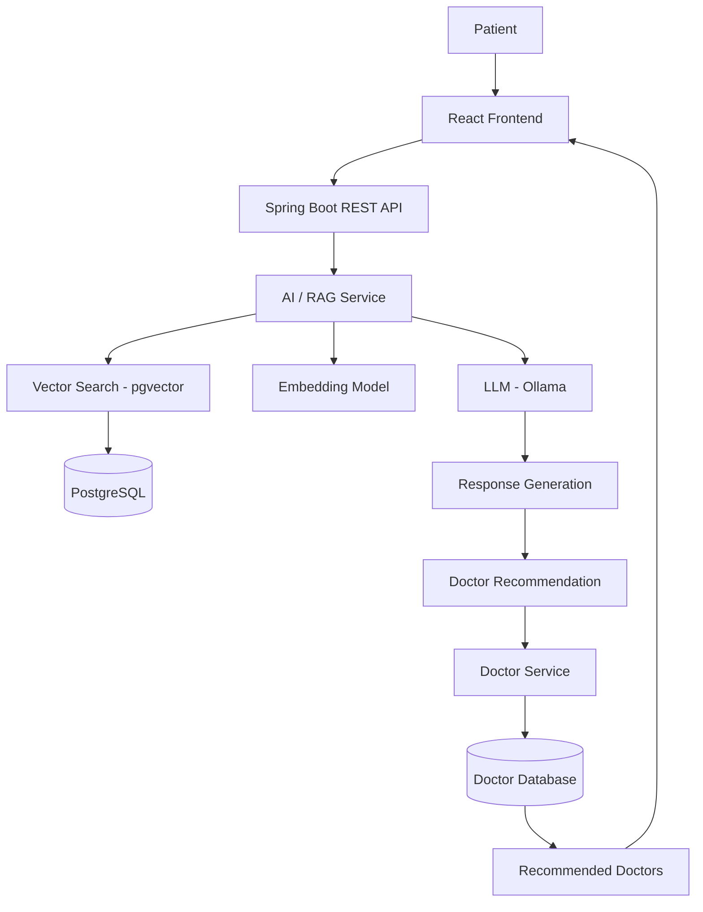

# 🏥 MedHub – AI-Powered Healthcare & Doctor Recommendation Platform

MedHub is an intelligent healthcare platform that helps patients find the right medical specialists based on their symptoms and medical history.

It leverages **Large Language Models (LLMs), Retrieval-Augmented Generation (RAG), and vector search** to understand patient queries, retrieve relevant medical knowledge, and recommend suitable medical specialists.

Instead of relying only on traditional keyword-based doctor searches, MedHub combines AI-powered symptom understanding with a structured doctor database to provide more relevant recommendations.

## 🚀 Key Features

### 🤖 AI-Powered Symptom Analysis
- Accepts patient symptoms through natural-language queries.
- Uses an LLM to understand and analyze patient concerns.
- Identifies potentially relevant medical specializations.
- Provides AI-generated responses with appropriate medical disclaimers.

### 📚 Retrieval-Augmented Generation (RAG)
- Ingests medical documents and healthcare knowledge sources.
- Extracts and processes text from PDF documents.
- Splits documents into smaller chunks for efficient retrieval.
- Generates vector embeddings.
- Stores embeddings in PostgreSQL with pgvector.
- Retrieves relevant context using semantic similarity search.
- Uses retrieved knowledge to generate context-aware responses.

### 👨‍⚕️ Intelligent Doctor Recommendation
- Identifies suitable medical specializations from patient symptoms.
- Uses AI tool calling to retrieve doctors from the Doctor Service.
- Fetches doctor information from the structured database.
- Returns relevant doctor recommendations.

### 🔍 Semantic Search
- Uses vector embeddings instead of relying exclusively on keyword matching.
- Retrieves semantically relevant medical information.
- Uses pgvector for vector similarity search.

### 🏗️ Microservices-Based Architecture
- Separates healthcare functionalities into independent services.
- Exposes REST APIs for communication between services.
- Supports independent development and scalability.

---

## 🧠 How MedHub Works

The application follows a Retrieval-Augmented Generation workflow.

1. Patient submits symptoms or a healthcare-related question.
2. The LLM analyzes the patient's query.
3. The RAG pipeline generates an embedding for the query.
4. pgvector retrieves relevant medical document chunks.
5. Retrieved context is provided to the LLM.
6. The LLM identifies a potentially relevant medical specialization.
7. AI tool calling fetches matching doctors from the Doctor Service.
8. The application returns an AI-generated response and doctor recommendations.

## 🏛️ System Architecture



## 🛠️ Technology Stack

| Category | Technologies |
|---|---|
| Backend | Java, Spring Boot |
| AI Framework | Spring AI |
| LLM | Ollama |
| Embeddings | Ollama Embedding Model |
| RAG | Retrieval-Augmented Generation |
| Vector Database | PostgreSQL, pgvector |
| Database | PostgreSQL |
| API Communication | REST APIs |
| Document Processing | Apache PDFBox |
| Frontend | React |
| Containerization | Docker |

## 📂 Project Architecture

The platform is organized around independent backend services.

```text
MedHub/
│
├── UserService/
│   └── User management and authentication
│
├── DoctorService/
│   └── Doctor and specialization management
│
├── DoctorSuggestion/
│   ├── AI-powered symptom analysis
│   ├── RAG implementation
│   ├── PDF document ingestion
│   ├── Document chunking
│   ├── Embedding generation
│   ├── Vector similarity search
│   └── Doctor recommendation
│
└── README.md
```

*Adjust the folder structure to match your actual GitHub repository.*

## ⚙️ RAG Pipeline

### 1. Document Ingestion
- Load medical PDF documents.
- Extract text using Apache PDFBox.
- Clean and preprocess extracted content.

### 2. Text Chunking
- Split large documents into smaller chunks.
- Preserve relevant document context.
- Process chunks in batches for efficient ingestion.

### 3. Embedding Generation
- Generate vector embeddings using an embedding model.
- Convert document chunks into numerical vector representations.

### 4. Vector Storage
- Store document content and embeddings in PostgreSQL.
- Use the pgvector extension for vector storage and similarity search.

### 5. Retrieval & Generation
- Convert patient queries into embeddings.
- Retrieve relevant document chunks using vector similarity.
- Pass retrieved context to the LLM.
- Generate context-aware responses.

## 💻 Getting Started

### Prerequisites

Make sure you have the following installed:

- Java 21
- Maven
- Docker Desktop
- PostgreSQL with pgvector
- Ollama
- Node.js and npm (for the frontend)

### 1. Clone the Repository

```bash
git clone https://github.com/YOUR_USERNAME/MedHub.git

cd MedHub
```

### 2. Start PostgreSQL with pgvector

```bash
docker run -d \
  --name medhub-postgres \
  -e POSTGRES_DB=medhub_rag \
  -e POSTGRES_USER=postgres \
  -e POSTGRES_PASSWORD=your_password \
  -p 5433:5432 \
  pgvector/pgvector:pg17
```

### 3. Install Ollama

Download and install Ollama:

https://ollama.com/

Pull the models configured in your application:

```bash
ollama pull YOUR_CHAT_MODEL
ollama pull YOUR_EMBEDDING_MODEL
```

### 4. Configure Application Properties

Configure your database and AI model settings in `application.properties` or `application.yml`.

Example:

```properties
spring.application.name=DoctorSuggestion

spring.datasource.url=jdbc:postgresql://localhost:5433/medhub_rag
spring.datasource.username=postgres
spring.datasource.password=${DB_PASSWORD}

spring.ai.ollama.base-url=http://localhost:11434
```

Add the remaining Spring AI model and pgvector configuration according to your application version.

### 5. Run the Backend

```bash
mvn clean install
mvn spring-boot:run
```

Repeat for the required microservices.

## 🔮 Future Enhancements

- [ ] Voice-based symptom input.
- [ ] Multilingual patient interaction.
- [ ] Integration with patient medical records.
- [ ] Conversation memory and personalized recommendations.
- [ ] Advanced hybrid search (vector + keyword search).
- [ ] RAG evaluation and retrieval accuracy measurement.
- [ ] LLM response quality evaluation.
- [ ] Doctor availability and appointment booking.
- [ ] AI response latency and performance monitoring.
- [ ] Cloud deployment using AWS.

## ⚠️ Medical Disclaimer

MedHub is an experimental healthcare assistance platform developed for educational and technological purposes.

AI-generated responses are informational and are not a substitute for professional medical diagnosis, treatment, or consultation. Patients should consult qualified healthcare professionals for medical advice.

## 👨‍💻 Author

**Saroyar Hossain Shaikh**

Software Engineer | Java Backend Developer | AI & Full-Stack Developer

GitHub: [Your GitHub Profile](https://github.com/YOUR_USERNAME)

LinkedIn: [Your LinkedIn Profile](YOUR_LINKEDIN_URL)

---

⭐ If you find this project interesting, consider giving it a star!